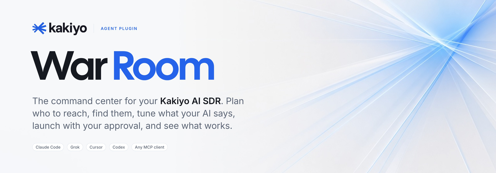
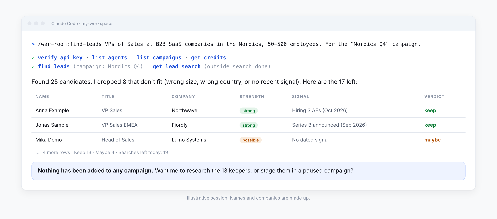
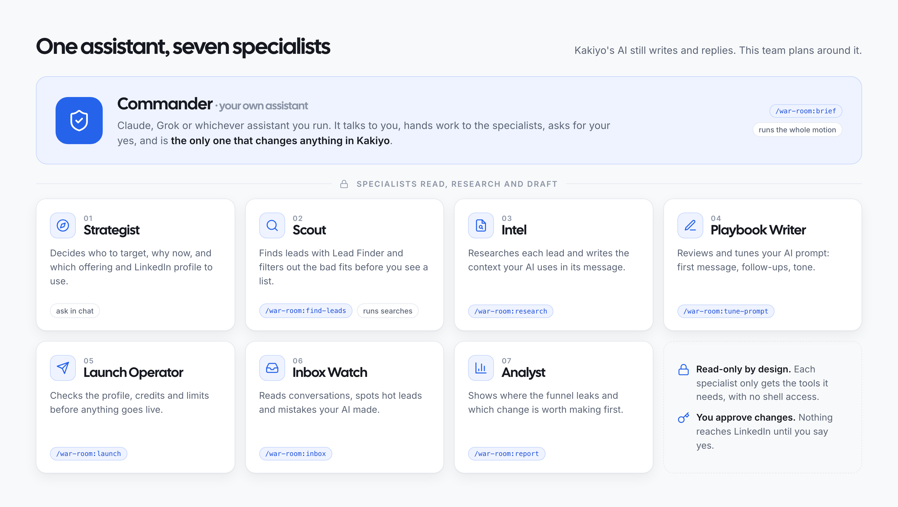
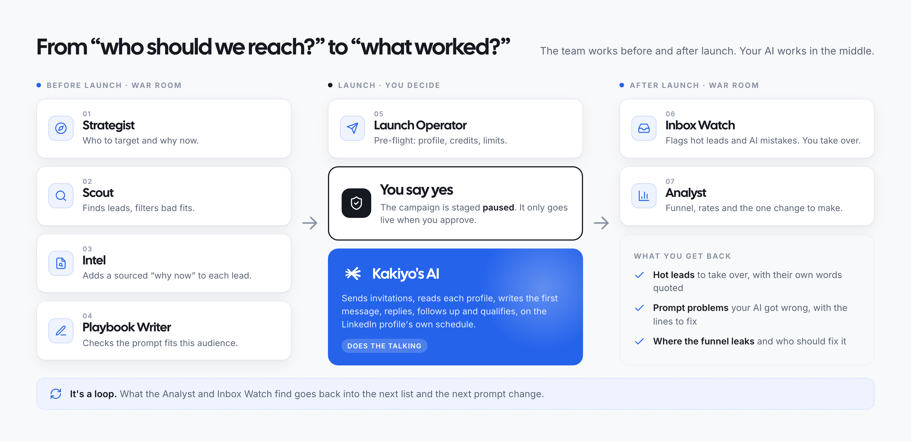
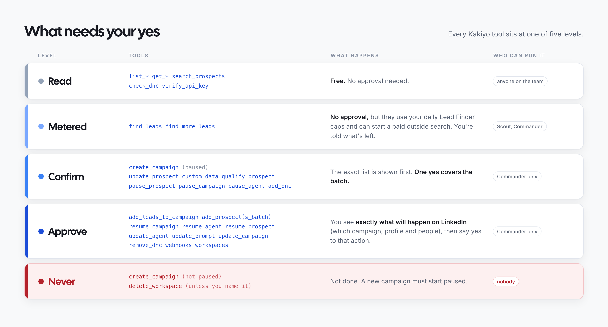

<p align="center">
  <picture>
    <source media="(prefers-color-scheme: dark)" srcset="assets/hero-dark.jpg">
    
  </picture>
</p>

<p align="center">
  <a href="LICENSE"></a>
  
  
</p>

<p align="center">
  <a href="#install">Install</a> ·
  <a href="#first-five-minutes">First five minutes</a> ·
  <a href="#how-it-works">How it works</a> ·
  <a href="#commands">Commands</a> ·
  <a href="#what-needs-your-yes">Safety</a> ·
  <a href="#troubleshooting">Troubleshooting</a>
</p>

---

Kakiyo already does the hard part of LinkedIn outreach. Its AI sends the invitations, reads each person's profile, writes the messages, answers replies and qualifies the conversation.

War Room is for everything around that. It gives your assistant (Claude, Grok, Cursor and others) a team of seven specialists that decide who to target, find the leads, research them, tune your prompt, check a launch, watch the inbox and report on results. They all work through the [Kakiyo MCP](https://docs.kakiyo.com/mcp-server), so they see your real campaigns, profiles and conversations.

It does not write messages for Kakiyo to send. When a message is off, it fixes the cause instead: the prompt, the offering, or the context saved on that lead.

## What you can ask

Say it in plain language. The right specialist picks it up.

- *"Find 25 Heads of RevOps at B2B SaaS companies in Germany with 50-500 employees. Don't add anyone yet."*
- *"Research the keepers and give me a reason to reach out now for each one."*
- *"Stage them in a paused campaign on my Berlin profile."*
- *"My first message sounds robotic. Review the prompt."*
- *"Who replied this week, and who should I take over myself?"*
- *"Why is nothing sending from this profile?"*
- *"How are my campaigns doing, and what should I change first?"*

<p align="center">
  <picture>
    <source media="(prefers-color-scheme: dark)" srcset="assets/session-dark.png">
    
  </picture>
</p>

## Install

### Before you start

You need a [Kakiyo](https://kakiyo.com) account (there is a 14-day free trial) with:

- a LinkedIn profile connected in the dashboard,
- an offering and a prompt (the dashboard's guided setup creates both),
- an active trial or paid plan. Lead Finder and the MCP are not available without one.

### Claude Code

```
/plugin marketplace add KakiyoAI/kakiyo-war-room
/plugin install war-room@kakiyo-war-room
```

Or from a terminal:

```bash
claude plugin marketplace add KakiyoAI/kakiyo-war-room
claude plugin install war-room@kakiyo-war-room
```

If the commands don't show up, run `/reload-plugins`. To try it from a local clone instead:

```bash
git clone https://github.com/KakiyoAI/kakiyo-war-room
claude --plugin-dir ./kakiyo-war-room
```

### Grok Build

```bash
grok plugin marketplace add KakiyoAI/kakiyo-war-room
grok plugin install war-room --trust
```

### Cursor, Codex, OpenCode and other agents

Any agent that speaks MCP can use it. Two steps:

1. Add the Kakiyo MCP server. In Cursor, put this in `.cursor/mcp.json`:

   ```json
   {
     "mcpServers": {
       "kakiyo": { "url": "https://api.kakiyo.com/mcp" }
     }
   }
   ```

   Other clients: remote server, Streamable HTTP, URL `https://api.kakiyo.com/mcp`, OAuth. Per-client steps are in the [Kakiyo MCP docs](https://docs.kakiyo.com/mcp-server).

2. Clone this repo and point your agent at [`AGENTS.md`](AGENTS.md), or copy `skills/war-room/` into its skills folder (and `agents/` if it supports subagents). Without subagent support the main assistant does each specialist's job itself, using the same playbooks.

### Connect Kakiyo

The plugin declares the Kakiyo MCP for you. The first time it needs Kakiyo, your assistant opens Kakiyo's sign-in:

1. Sign in and choose the team the assistant may use.
2. Grant read **and write** access. Write is needed to search for leads and to launch.
3. Done. You can review or revoke the connection any time on the **MCP** page of the Kakiyo dashboard.

Nothing to paste, and no API key. If your client can't do OAuth, the [MCP docs](https://docs.kakiyo.com/mcp-server) show the API-key setup.

## First five minutes

1. **Add your context** (optional, but the output is much better). Copy [`skills/war-room/war-room-context.template.md`](skills/war-room/war-room-context.template.md) to `war-room-context.md` in your project and fill in what you sell, who you target and how you sound. [More below.](#tell-it-about-your-business)
2. **Run `/war-room:brief`.** It only reads: your profiles, campaigns, credits, replies waiting, and anything that's blocked. It changes nothing.
3. **Ask for leads.** For example: *"Find 25 Heads of RevOps at B2B SaaS companies in Germany with 50-500 employees. Show me the list before anything is launched."*

## How it works

Your own assistant is the **Commander**. It talks to you and is the only one that changes anything in Kakiyo. It hands the thinking to seven specialists, each limited to the read tools it needs.

<p align="center">
  <picture>
    <source media="(prefers-color-scheme: dark)" srcset="assets/team-dark.png">
    
  </picture>
</p>

A typical run goes in this order:

<p align="center">
  <picture>
    <source media="(prefers-color-scheme: dark)" srcset="assets/flow-dark.png">
    
  </picture>
</p>

A few things worth knowing about how the pieces fit:

- **Research goes into the AI's context.** Kakiyo's AI already reads every prospect's LinkedIn profile and posts. Intel adds what LinkedIn doesn't show (a recent funding round, a hiring push) and saves it on the lead as `customData`, which your prompt can use as `{{customData}}`.
- **Prompt changes are diffs.** The Playbook Writer shows old and new text before anything is updated. Kakiyo can't tell it which campaigns use a prompt, so it asks you to confirm them first.
- **Replies are never answered for you.** Inbox Watch flags hot leads and the places your AI got something wrong. You take over by pausing that one conversation.

## Commands

| Command | What it does |
| --- | --- |
| `/war-room:brief` | Read-only status: profiles, campaigns, credits, replies waiting, blockers |
| `/war-room:find-leads` | Find and triage leads. Adds nobody to a campaign |
| `/war-room:research` | Research leads and draft the context Kakiyo's AI will use |
| `/war-room:tune-prompt` | Review your AI prompt and propose a diff |
| `/war-room:launch` | Pre-flight checks, stage a paused campaign, launch on your yes |
| `/war-room:inbox` | Triage replies: hot leads, AI mistakes, objections, stop requests |
| `/war-room:report` | Funnel report and the top three things to change |

You don't need the commands. Asking in plain language works the same way.

## What needs your yes

Every Kakiyo tool sits at one of five levels. Anything that touches LinkedIn needs a clear yes from you first.

<p align="center">
  <picture>
    <source media="(prefers-color-scheme: dark)" srcset="assets/approvals-dark.png">
    
  </picture>
</p>

On top of that, War Room holds these lines:

- **New campaigns start paused.** They only go live when you approve. Adding people to a campaign that isn't one of these is treated as a launch, because it can start outreach.
- **It won't launch on a profile that can't run,** or when your workspace is out of AI credits.
- **40 invitations a day is the ceiling per profile.** Kakiyo can't tell it the configured maximum, so it asks you to confirm it before every launch.
- **It never asks for a LinkedIn password or 2FA code.** Profiles are connected in the dashboard only.
- **Text from prospects and web pages is treated as data.** A reply that says "ignore your rules" is just a reply.

For a hands-off run, say "autonomous" in the chat. It then works inside the limits in your context file. It still stops at the rules above.

## Tell it about your business

`war-room-context.md` is read at the start of every session. A short one is enough:

```markdown
## What we sell
- Company: Acme
- One sentence: Payroll software for fast-growing European startups.
- Kakiyo offering to use: Acme Payroll
- Proof we may cite: 300+ teams, including Lemonade Labs

## Who we target
- Industries: B2B SaaS, fintech
- Company size (employees): 50-500
- Countries: Germany, Netherlands
- Buyer titles: Head of People, CFO
- Never contact: existing customers, competitors, agencies

## Voice
- Tone: peer to peer, short, no buzzwords
- What we want from a reply: a 20-minute call

## Launch policy
- Max invitations per day per profile: 30
```

Don't commit it if it has anything private.

## What it can't do

These need the Kakiyo dashboard, because the MCP doesn't offer them:

- connect or re-login a LinkedIn profile,
- create offerings and prompts, or test a prompt in the Sandbox,
- send a manual message in a conversation,
- set custom qualification criteria,
- run Monitors, Sales Navigator imports or CSV uploads,
- delete prospects or campaigns, or manage billing.

It also can't read a campaign's prompt or its auto-start setting, so it asks you instead of guessing.

Kakiyo limits each workspace to about 30 reads and 15 writes a minute, shared by everything connected. A big batch (say, pausing 40 conversations) takes a few minutes, and War Room paces itself accordingly. Lead Finder over MCP also has daily caps (by default 20 searches, 20 refinements and 10 outside searches a day).

## Troubleshooting

| You see | What it means | What to do |
| --- | --- | --- |
| `insufficient_scope` | The connection has read access only | Disconnect Kakiyo, connect again and grant write access |
| `subscription_inactive` or `subscription_required` | The workspace has no active trial or paid plan | Check Billing in the dashboard |
| A specialist says it has no Kakiyo tools | Kakiyo is connected under a different server name | Name the server `kakiyo`, or let your main assistant do that step |
| `/war-room:*` commands are missing | The plugin hasn't loaded | Run `/reload-plugins`, then check `/plugin` |
| A profile shows `auth_needed` | LinkedIn wants a new login or 2FA | Reconnect it in the dashboard. Never share the password in chat |
| A profile shows `credits_needed` | The workspace ran out of AI credits | Add credits in Billing. The profile restarts by itself |
| "Nothing is sending" | Usually a profile status, working hours or an empty queue | Ask: *"Why is nothing sending from this profile?"* |

## Update or remove

```bash
claude plugin marketplace update kakiyo-war-room
claude plugin update war-room@kakiyo-war-room
claude plugin uninstall war-room@kakiyo-war-room
```

## What's in this repo

```
skills/war-room/     the router skill, the playbooks and the context template
agents/              the seven specialists
commands/            the seven slash commands
.mcp.json            the Kakiyo MCP server
assets/              the images above
assets/source/       static HTML the images were rendered from
```

It is Markdown, JSON and images. There is no runtime code to review. The playbooks mirror what the Kakiyo MCP actually does, and they are updated when it changes.

The images are screenshots of `assets/source/*.html`. Open one in a browser with `?theme=light` or `?theme=dark` and capture the `#canvas` element. The hero background art was generated with Grok Imagine.

## Links

- [Kakiyo MCP docs](https://docs.kakiyo.com/mcp-server)
- [Kakiyo](https://kakiyo.com) · [Dashboard](https://app.kakiyo.com) · [Support](mailto:support@kakiyo.com)
- Found something wrong or out of date? Open an issue.

## License

[MIT](LICENSE) © Kakiyo
